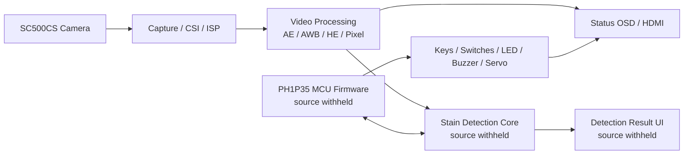

# PH1P35 光伏视觉系统公开组件

> Embedded FPGA vision platform for photovoltaic panel inspection  
> Public component release / competition-safe edition

本项目基于安路 `PH1P35MDG324`、HX1P35A 开发板和 SC500CS 摄像头，构建光伏板异物检测与板级控制原型。系统完成了摄像头采集、图像处理、实时显示、环境信息显示、MCU 联调和异物识别等功能的原型验证。

当前仓库是**竞赛期间的安全公开版**，不是完整产品的源码包。MCU 固件、污渍检测核心算法、训练数据、模型和完整顶层集成已经实现，但暂时不在本仓库公开；比赛结束后将按本文末尾的计划逐步补充核心代码。

## 当前状态

| 功能 | 原型状态 | 当前开源内容 |
|---|---|---|
| SC500CS 720p 视频采集与显示 | 已实现 | 公开相关接口说明与可复用组件 |
| FPGA 图像处理 | 已实现 | 公开 AE、AWB、直方图、像素处理和状态叠加模块 |
| 按键、拨码、LED、数码管和蜂鸣器 | 已实现 | 公开 RTL 与 ModelSim 测试 |
| MG996R PWM 控制 | 已实现 | 公开舵机 PWM RTL 与 ModelSim 测试 |
| TF 卡 SPI 探测 | 已实现 | 公开独立 RTL、TD 工程与仿真 |
| MCU 固件 | 已实现 | 仅说明，源码赛后公开 |
| 污渍检测与目标分类算法 | 已实现 | 仅说明，源码、模型和数据赛后公开 |
| 完整系统顶层与 `.bit` | 已实现并完成原型集成 | 暂不公开发布 |

“已实现”表示这些功能已经在比赛原型中完成设计和联调，但不表示当前公开源码可以直接生成完整位流。

## 公开范围

当前仓库包含：

- 视频流接口和图像处理基础模块；
- 自动曝光、自动白平衡、直方图均衡和显示亮度控制；
- 状态 OSD、按键和拨码消抖、模式控制；
- 数码管、蜂鸣器和舵机 PWM；
- 帧编号、跨时钟域快照和摄像头帧看门狗；
- TF 卡 SPI 独立探测工程；
- ModelSim 一键编译和自检测试。

当前仓库明确不包含：

- PH1P35 MCU 启动、BSP、应用固件和 APB 联调代码；
- 污渍检测、连通域、形态分类、目标定位和风险决策算法；
- 训练脚本、权重、量化模型、验证数据和数据集；
- 包含私有算法接口的完整顶层、TD 工程和可烧录 `.bit`。

详见 [开源范围与赛后计划](docs/release-scope.md)。

## 系统概览



公开组件不包含图中的私有检测核心和 MCU 实现。系统设计边界和时钟域说明见 [架构说明](docs/architecture.md)。

## ModelSim 仿真

ModelSim 10.6d 已零错误编译全部公开 RTL 和测试平台。发布机上的 `vsim` 因许可证环境无法启动，因此同一批 12 个自检测试另用 Icarus Verilog 全量执行并全部通过；ModelSim 的一键运行脚本仍会随仓库提供。

Windows 一键运行：

```powershell
cd sim\modelsim
.\run_all.ps1
```

也可以运行：

```bat
sim\modelsim\run_all.bat
```

脚本会依次执行 `vlib`、`vmap`、`vlog -sv` 和 `vsim -c`。仿真方法和单测命令见 [ModelSim 仿真](docs/simulation.md)。

## TD 工程

`TF_SPI_STANDALONE/` 是独立、较小的 TF/SPI 上板探测工程，可直接用安路 TD 6.2 打开：

```text
TF_SPI_STANDALONE/td_project/tf_probe.al
```

完整视频顶层依赖未公开的检测核心，不随本仓库发布。公开 RTL 可导入你自己的 TD 工程；具体约束和资源情况必须按实际板卡重新确认。

## 文档

- [架构说明](docs/architecture.md)
- [ModelSim 仿真](docs/simulation.md)
- [TD 编译与上板](docs/build.md)
- [验证说明](docs/verification.md)
- [开源范围与赛后计划](docs/release-scope.md)

## 许可

本仓库公开部分采用 [MIT License](LICENSE)。该许可不覆盖未公开的 MCU 固件、污渍检测核心算法、训练数据、模型、比赛报告或第三方厂商 IP。

使用安路 TD、SC500/SC520 参考代码、第三方 IP 或板卡资料时，请遵守对应厂商和原始作者的许可与使用条款。

## 赛后开源计划

比赛结束后计划依次发布：

1. 完整模块边界和接口说明；
2. 污渍检测 RTL、后处理逻辑和测试平台；
3. MCU 固件、TF 卡模型读取和 PC 侧验证脚本；
4. 可复现的数据集说明、训练和量化流程；
5. 与当前硬件版本对应的顶层、约束和已清洗的历史；
6. 独立实验结果和已知限制。

在核心代码发布前，本仓库中的“已实现”描述仅用于准确说明原型状态，不应被解释为当前版本可以直接构建完整系统。

