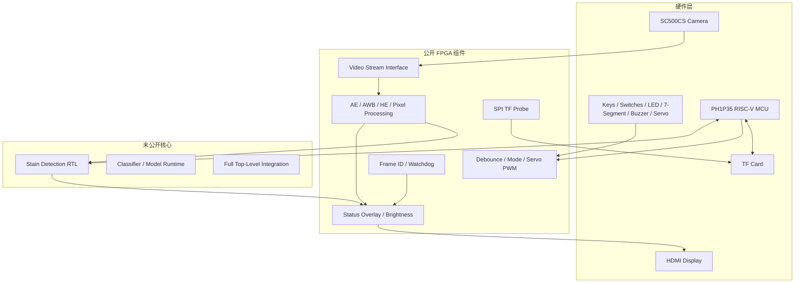

# 架构说明

## 1. 设计目标

系统面向光伏板表面异物巡检，目标是在 PH1P35 FPGA 上完成实时视频处理、状态显示和板级控制，并由片上 MCU 完成后续决策与外设协同。

公开版只发布可独立复用的模块、接口和测试，不公开完整产品拓扑中的敏感实现。

## 2. 系统分层

## 3. 视频处理链

公开版提供以下基础能力：

- 按帧统计亮度和颜色分布；
- 自动曝光所需的统计与数字补偿；
- 自动白平衡；
- 直方图均衡；
- 灰度、二值化、Sobel 和颜色量化等基础像素处理；
- 状态字符叠加与显示端亮度调整；
- 视频帧编号和跨时钟域快照。

完整系统中的污渍检测核心接收视频统计与像素数据，输出目标候选和分类结果。该核心及其与 MCU 的完整连接逻辑不在当前公开包中。

## 4. 板级控制

公开控制模块包括：

- 按键同步、消抖、短按和长按事件；
- 拨码开关持续电平控制；
- 运行模式选择；
- 数码管动态扫描；
- 蜂鸣器报警节拍；
- MG996R 舵机 50 Hz PWM 和软限位扫动。

这些模块可以独立仿真，也可以接入其他视频工程。

## 5. TF 卡接口

公开包中的 `TF_SPI_STANDALONE/` 用于验证 TF 卡 SPI 物理连接和 CMD0 握手。它只探测 SD 卡响应，不读取模型，不包含 MCU APB 应用，也不包含 AI 推理。

完整系统中的 MCU、FAT32、模型读取、CRC 校验和分类推理属于赛后发布范围。

## 6. 时钟与复位原则

跨时钟域数据必须通过以下方式之一处理：

- 厂商原语 FIFO；
- 双口 RAM 或帧缓存；
- 单比特翻转握手与同步器；
- 明确的复位同步。

禁止把同一多比特总线直接跨时钟域采样。公开的 `frame_id_snapshot_cdc.v` 展示了单比特翻转事件触发的一致性快照方法。

## 7. 完整系统边界

当前公开包不提供 `design_top_wrapper` 或完整 `vision_pipeline`。原因是这两个文件直接例化污渍检测、MCU 和私有状态机，公开后会暴露核心实现。

赛后发布完整顶层时，将同时提供：

- 板级引脚约束；
- TD 源文件顺序；
- 器件和速度等级；
- 资源利用率与时序结果；
- 公开模型格式；
- MCU 与 FPGA 的 APB 接口约定。

